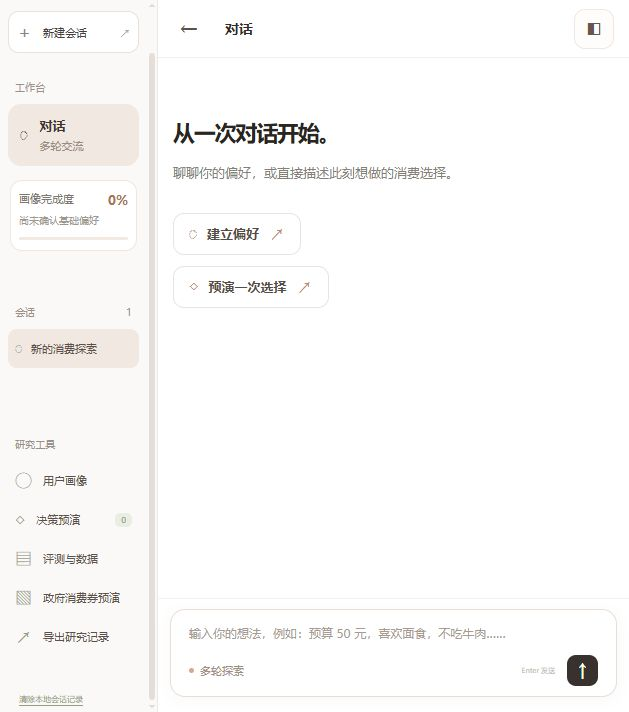
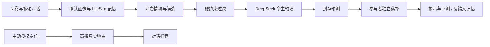

# 消费者孪生行为预演与消费券模拟平台

基于 [LifeSim](https://github.com/dfy37/lifesim) 的消费者行为研究原型。参与者先填写并确认自己的画像，再与代理多轮对话；系统在给定消费情境和候选集合下封存孪生选择预测，待参与者独立作答后展示预测和理由，用于比较“模拟选择”与“真实选择”。网页也支持在用户主动授权定位后查询周边真实店铺，并在对话中给出基于这些店铺的建议。

> 当前是可运行的本地研究原型，不是已经通过实证验证的消费者选择模型。真实周边店铺用于对话推荐；行为预演目前使用标明为虚构的研究候选。政府消费券入口已预留，政策数据和正式评测尚未接入。



## 目前可以做什么

- **画像与多轮交互**：问卷记录每餐预算、口味、饮食限制等明确回答；对话中提取的新偏好须由参与者确认。LifeSim 原生画像、代理、记忆与对话模拟是运行基础。
- **消费决策预演**：先检查预算、距离、过敏原等硬约束，再由 DeepSeek 结合画像、情境和记忆进行候选排序与理由生成。预测先在服务端封存，参与者选择或跳过后才揭示。
- **反事实分支**：可从同一画像与记忆快照比较预算或消费券条件的改变，避免把后续反馈倒灌到已封存预测。
- **真实周边推荐**：点击定位并授权后，高德 Web 服务返回附近餐厅或商店；对话使用本次查询的真实候选。地点价格、营业、食材和优惠信息可能缺失，不能据此保证适合过敏者或可使用消费券。
- **研究记录**：本机保存会话、预测、参与者选择与满意度反馈，支持导出。工程测试和联通探针不得当作真人研究样本。



## 本地启动

建议使用 Windows、Python 3.10。项目不需要另装前端构建工具，网页静态文件已在仓库中。DeepSeek、硅基流动嵌入和高德地点服务分别需要自己的 API Key；密钥只由本地后端读取。

```powershell
py -3.10 -m venv .venv
.\.venv\Scripts\python.exe -m pip install -e ".[lifesim]"
Copy-Item config\consumer_lifesim.example.json config\consumer_lifesim.local.json
Copy-Item config\secrets.example.json config\secrets.local.json
```

在 `config/secrets.local.json` 填入自己的 `deepseek_api_key`、`siliconflow_api_key`；如需真实周边店铺，再填 `amap_web_service_key`（高德开放平台的 **Web 服务 Key**）。这两个 `.local.json` 文件已被 Git 忽略，不要提交、截图或发到聊天。

```powershell
.\.venv\Scripts\python.exe scripts\serve_consumer_workbench.py
```

浏览器打开 **http://127.0.0.1:5173/**。Windows 也可双击 `启动网页Demo.cmd`，但首次使用仍须先完成上面的环境与密钥配置。页面不是账号登录；数据只保存在本机。首次对话需等待模型及嵌入接口返回，服务异常会显示错误，不会伪装成真实模型回复。

## 目录

| 路径 | 内容 |
| --- | --- |
| `sites/mirra-consumer-demo/dist/` | 本地网页界面 |
| `src/consumer_behavior/` | 问卷、情境、约束、决策、地点查询、研究服务与存储 |
| `LifeSim/upstream-lifesim/` | LifeSim 固定修订的本地源码及消费者代理扩展 |
| `scripts/` | 启动、演示与检查脚本 |
| `docs/consumer_agent_research_protocol.md` | 研究问题、数据与评测设计 |
| `docs/consumer_research_api.md` | 多轮研究与地点接口 |
| `config/*.example.json` | 不含密钥的配置样例 |
| `data/examples/` | 虚构研究候选及示例事件 |

运行中生成的会话数据库、模型缓存、下载的数据集、训练权重与本机密钥均不入库。`PLAN.md` 保留项目演进记录，其中早期点击预测实验是可选研究方向，**不是**当前产品的必要依赖。

## 研究与评测状态

第一版决策模块不训练新的点击模型。公开点击数据集只适合探索点击预测基线，不能直接验证当前平台能否预测某位参与者选择哪家餐厅。正式评测应固定候选和情境，记录封存预测与参与者独立选择，比较选择命中率、排序指标、约束违规率、理由可解释性，以及随反馈增加后的变化；还需区分对话质量和行为预测质量。具体方案见 [研究协议](docs/consumer_agent_research_protocol.md)。目前尚无正式参与者研究或经校准的选择概率。

```powershell
.\.venv\Scripts\python.exe -m unittest discover -s tests -v
```

测试中的 LLM、嵌入和地图接口可由替身实现覆盖；通过工程测试不等于取得真实用户行为的预测准确率。

## 来源与使用边界

LifeSim 上游为 [`dfy37/lifesim`](https://github.com/dfy37/lifesim)，本地固定修订记录见 `LifeSim/upstream-lifesim/SOURCE_REVISION.txt` 和 `RESTORED_SOURCE_MANIFEST.json`。本项目在原画像、记忆和对话框架上增加消费者决策与研究工作流。上游仓库目前未声明许可证；使用或再分发上游代码前应核实相应权利。地图地点数据来自高德接口，研究者还需遵守其服务条款及参与者知情同意要求。
